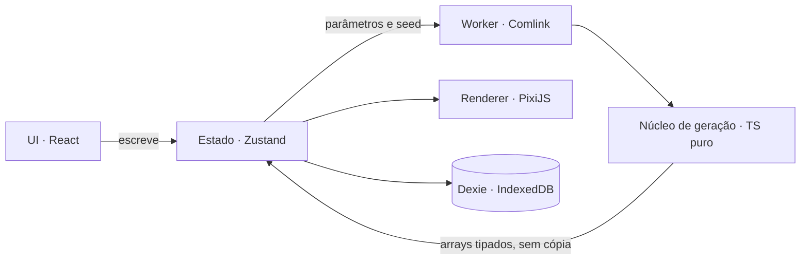

# Visão geral

## Resumo

Aplicação web para mestres de RPG e worldbuilders gerarem, a partir de uma seed, um mapa cartoon
de um mundo fictício e marcarem nele cidades, NPCs e locais, com anotações em cada pin. Roda no
navegador e salva os mundos localmente. Visão e escopo em [prd.md](prd.md).

## Stack

Decidida no [ADR 0001](adr/0001-stack-da-v1.md). Hospedagem no
[ADR 0002](adr/0002-hospedagem-github-pages.md). O app é só local na v1
([ADR 0003](adr/0003-app-so-local-na-v1.md)).

| Camada | Escolha | Por quê | ADR |
|---|---|---|---|
| Build | Vite | Rápido, já conhecido do RPG-land, suporte nativo a workers | [0001](adr/0001-stack-da-v1.md) |
| Linguagem | TypeScript (strict) | Tipos para o modelo do mundo e para a fronteira com o worker | [0001](adr/0001-stack-da-v1.md) |
| UI | React 19 | Sidebar, drawer e formulários; não participa do loop de render do mapa | [0001](adr/0001-stack-da-v1.md) |
| Componentes | shadcn/ui (Radix) + Tailwind CSS | Slider, Sheet (drawer), Dialog e Tabs acessíveis e customizáveis | [0001](adr/0001-stack-da-v1.md) |
| Estado | Zustand (+ middleware `temporal` do zundo para desfazer) | Simples, sem boilerplate, legível fora do React pelo renderer | [0001](adr/0001-stack-da-v1.md) |
| Render 2D | PixiJS v8 | WebGL/WebGPU, sprites em lote, ideal para milhares de ícones e pins | [0001](adr/0001-stack-da-v1.md) |
| Câmera | pixi-viewport | Pan, zoom no cursor, pinça, inércia e limites prontos | [0001](adr/0001-stack-da-v1.md) |
| Ruído | simplex-noise (`createNoise3D`) + alea | Ruído 3D permite migrar para esfera sem trocar o gerador | [0001](adr/0001-stack-da-v1.md) |
| Worker | Comlink | Chamada assíncrona tipada; transfere `ArrayBuffer` sem cópia | [0001](adr/0001-stack-da-v1.md) |
| Formulários | react-hook-form + zod | Validação dos dados do pin e do JSON importado | [0001](adr/0001-stack-da-v1.md) |
| Texto rico | TipTap | Descrições de locais e NPCs com formatação | [0001](adr/0001-stack-da-v1.md) |
| Persistência | Dexie (IndexedDB) | Guarda mundos e imagens enviadas (blobs) sem limite de 5 MB | [0001](adr/0001-stack-da-v1.md) |
| Testes | Vitest + Playwright | Unitário do gerador; E2E dos fluxos de pin e sidebar | [0001](adr/0001-stack-da-v1.md) |
| 3D (futuro) | Three.js via react-three-fiber | Esfera, iluminação e câmera orbital | [0001](adr/0001-stack-da-v1.md) |
| Hospedagem | GitHub Pages (build estático) | App estático, repositório público | [0002](adr/0002-hospedagem-github-pages.md) |

**Alternativas descartadas** (detalhes no ADR 0001)

- **Leaflet:** pensado para tiles de servidor; dar estilo cartoon e regerar o mapa a cada slider
  exige lutar contra a biblioteca.
- **Canvas 2D puro (como no RPG-land):** sem GPU, milhares de ícones e zoom suave ficam lentos.
- **Three.js já na v1:** resolveria a esfera, mas pins, rótulos e estradas 2D custam bem mais;
  melhor entrar só na fase 3D.
- **Vue:** viável, mas o RPG-land já é React e o ecossistema de componentes acessíveis é maior.

## Desenvolvimento

Pré-requisito: a versão do Node do arquivo `.nvmrc` (a mesma que o CI usa).

Depois de instalar as dependências uma vez com `npm install`, o app roda com um único comando:

```bash
npm run dev
```

O `npm run dev` sobe o app em `http://localhost:5173`.

| Comando | O que faz |
|---|---|
| `npm run dev` | Servidor de desenvolvimento do Vite |
| `npm run lint` | Lint com oxlint (`.oxlintrc.json`) |
| `npm run typecheck` | Checagem de tipos (`tsc -b`, TypeScript strict) |
| `npm test` | Testes com Vitest (ambiente jsdom) |
| `npm run e2e` | E2E com Playwright em `e2e/`, no Google Chrome instalado: o app no servidor de desenvolvimento (porta 5199) e o build no `vite preview` em `/rpg-world/` (porta 5198; localmente faz o build antes) |
| `npm run build` | Tipos + build de produção em `dist/`, com o caminho base `/rpg-world/` do GitHub Pages |
| `npm run preview` | Serve o `dist/` em `http://localhost:4173/rpg-world/`, como no Pages |

O mockup estático do mapa (spike visual do M0) abre em `/mockup.html`, no dev e no build
(`http://localhost:5173/mockup.html`). A paleta e o spritesheet dos ícones ficam em
`src/render/style/`, com a origem e a licença dos ícones no `README.md` dessa pasta.

O núcleo de geração fica em `src/core/`. O teste de
determinismo (`e2e/determinismo.spec.ts`) roda o núcleo no Chrome, no Firefox e no WebKit e
compara o hash do campo com o de referência (`src/core/world/golden.ts`), o mesmo que o Vitest
confere no Node. Firefox e WebKit são os navegadores do Playwright.

Limite: o "WebKit" desse teste é o build de WebKit do Playwright, que roda no Linux (CI) e no
Windows (local). É o mesmo motor JavaScript do Safari (JavaScriptCore), mas não é o Safari no
macOS nem no iOS, que ninguém testa hoje.

Para rodar o `npm run e2e` localmente, instale os navegadores uma vez:

```bash
npx playwright install firefox webkit
```

No Windows, se o caminho do usuário tem acento (ex.: `C:\Users\Usuário`), o Firefox do
Playwright não abre ("configuração lado a lado incorreta"). Instale os navegadores num caminho
sem acento, definindo `PLAYWRIGHT_BROWSERS_PATH` (ex.: `C:\pwtmp`) antes do `install` e do
`npm run e2e`.

O núcleo não usa funções Math transcendentes (`sin`, `exp`, `pow`…) nem o operador `**`, que
podem variar entre engines (RNF-4), e só depende da seed: nada de `Math.random`, `Date`,
`performance` ou `crypto`. A varredura aceita só uma lista de funções Math exatas (`floor`,
`sqrt`, `min`, `imul`…), então o acesso indireto (`Math['pow']`) também é pego.
`src/core/determinism.test.ts` confere o código do núcleo e o
das bibliotecas `alea` e `simplex-noise`, e falha se uma delas passar a importar outro módulo. Mudar
o gerador de propósito exige subir `GENERATOR_VERSION` (`src/core/types.ts`) e atualizar os hashes
de referência. As versões de `alea` e `simplex-noise` ficam fixadas, sem `^`, no `package.json`:
trocar a versão delas também é mudar o gerador.

O worker de geração (spike de desempenho do M0) fica em `src/workers/`: o
`generator.worker.ts` expõe o núcleo pelo Comlink e devolve os arrays por transferência, sem cópia,
e o `generatorClient.ts` cria o worker na thread principal. Cada pedido ganha um número de versão
(`latestOnly.ts`): fica no máximo um pedido no worker e um na espera, um pedido novo toma o lugar
do que esperava, e um resultado que chega depois de um pedido mais novo é descartado; quem perdeu a
vez recebe `null`. A página de medição abre em `/bench.html`, no dev e no build
(`http://localhost:5173/bench.html`): o botão "Medir" mede a prévia 256² e o mapa 1024² (medianas
depois de uma geração de aquecimento), simula o arrasto de um slider e compara o maior intervalo
entre quadros da UI com a mesma geração feita na thread principal. Meça com a aba à vista: com ela
escondida, o navegador espaça quadros e timers, e a página avisa que o resultado não vale. O
`e2e/desempenho.spec.ts` roda a medição no Chrome e confere as metas, num projeto do Playwright
que roda depois dos outros e sozinho, para a disputa pela CPU não atrasar os quadros da UI. As
metas de tempo só são conferidas fora do CI, que é uma máquina compartilhada; no CI ficam a
transferência sem cópia e o cancelamento.

O spike dos 5.000 sprites (M0) fica em `src/sprites/` e abre em `/sprites.html`, no dev e no build
(`http://localhost:5173/sprites.html`): terreno em textura única, 5.000 ícones do mesmo spritesheet
num grupo de render do Pixi, sem culling, e pixi-viewport com pan, zoom no cursor e pinça. O botão
"Medir automático" roda 30 s de câmera roteirizada, igual em toda máquina; "Medir manual" conta os
30 s enquanto a pessoa faz pan e zoom, e não vale se faltar um dos dois gestos. O fps mínimo é o da
pior janela de 1 s, e o relatório traz o
navegador, a GPU e a tela. Meça com a aba à vista, no Chrome, sem outras abas com a cena, que
disputam a GPU, e registre o relatório no PR. Registre duas medições: uma logo depois de abrir o
Chrome e outra com ele aberto há pelo menos 1 minuto. Na RX 7600, as medições logo depois de abrir
foram as piores (uma chegou a 1 fps, sem causa confirmada). A hipótese é a atividade de partida do
navegador: o JS ficou abaixo de 7 ms por quadro e não houve tarefas longas, mas isso não descarta
custo na GPU ou no driver. O
`e2e/sprites.spec.ts` confere a cena, a câmera e o relatório, mas não o fps: o Chrome do teste não
usa a GPU.

O CI (`.github/workflows/ci.yml`) roda lint, tipos, testes, build e E2E em todo PR que não é só de
docs; antes do E2E, instala o Firefox e o WebKit do Playwright.

### Publicação

Cada push na `main` publica o build no GitHub Pages pelo workflow `.github/workflows/pages.yml`
([ADR 0002](adr/0002-hospedagem-github-pages.md)): https://lorenasilvado.github.io/rpg-world/.
O repositório precisa estar com Settings → Pages → Source em "GitHub Actions".

## Arquitetura

Quatro camadas que só conversam por contratos: UI (React), estado (Zustand), núcleo de geração (TS
puro no worker) e renderer (Pixi). O núcleo não conhece React nem Pixi; por isso o renderer 3D
futuro reaproveita tudo. A UI só escreve no estado; o worker devolve arrays prontos e o renderer
apenas desenha o que o estado contém.



### Estrutura de pastas

```
src/
  core/                 # TS puro, sem React/Pixi; 100% testado
    rng/                # seed, alea
    noise/              # fbm, ridged, domain warp (ruído 3D)
    world/              # generateWorld, campos, quantis, biomas
    decor/              # Poisson-disk para árvores/montanhas
    routing/            # A* e suavização de estradas
    projection/         # Plane (v1) e Sphere (futuro)
    types.ts
  workers/
    generator.worker.ts # expõe o core via Comlink
  render/
    MapRenderer.ts      # cria app Pixi + viewport
    layers/             # TerrainLayer, DecorLayer, RoadLayer, PinLayer, LabelLayer
    style/palette.ts    # cores e tons por bioma
  state/
    worldStore.ts       # seed, parâmetros, status da geração
    pinsStore.ts        # pins + undo
    roadsStore.ts
    uiStore.ts          # ferramenta ativa, pin selecionado
  features/
    sidebar/  pins/  roads/  worlds/
  persistence/
    db.ts               # Dexie
    exportImport.ts     # JSON + schema zod
  app/
    App.tsx  routes.tsx
```

### Pipeline de geração

1. **Amostragem:** para cada célula, a projeção converte (u, v) num ponto 3D; na v1 é um plano, no
   futuro um ponto na esfera.
2. **Elevação:** máscara continental + fBm com domain warp + cordilheiras por ridged noise. Com o
   Tamanho do continente abaixo de 50, estreitos separam a terra em ilhas. Perto da borda, o terreno
   afunda: uma queda circular arredonda o contorno, e uma faixa estreita afasta a terra da moldura.
3. **Umidade e temperatura:** fBm com gerador próprio da seed (`seed#clima`), amostrado numa grade
   de 4 células e interpolado; a temperatura cai com a altitude e com a distância do "equador" do
   mapa, e a Temperatura global a desloca por igual.
4. **Classificação por quantis**, na ordem água → praia → montanha → deserto ou floresta → campo:
   o nível do mar é o percentil igual ao slider de oceano. A praia vem da distância até a água
   (passo 5). Montanhas usam o percentil da elevação, e a neve, o da temperatura entre as
   montanhas. Sobre a terra que sobrou, as células mais áridas viram deserto até atingir o
   percentual pedido, e as mais úmidas viram floresta; o campo alto vira colina, e o campo abaixo da geada fica gelado.
5. **Praias:** faixa de largura configurável a partir da costa, por distância chanfrada até a água,
   não por altura.
6. **Sombreamento:** hillshade pela inclinação, com luz do noroeste, guardado em `Int8Array`.
7. **Rios e lagos:** sem hidrologia ([ADR 0008](adr/0008-nascentes-na-terra-alta-e-depressoes-pequenas.md)),
   em `src/core/world/rivers.ts`: rios descem pelo gradiente, da terra alta até o mar ou um lago; o
   lago ocupa a depressão onde a descida fica presa. O traçado só depende da seed e da elevação,
   e o rio é cortado na costa atual. No código, este passo roda logo depois da elevação, porque o
   lago entra na classificação.
8. **Decoração:** Poisson-disk gera posições de ícones por bioma (árvores, montanhas, picos, dunas).
9. **Entrega:** os arrays voltam ao React por transferência sem cópia; o renderer monta uma textura
   RGBA única e os sprites de decoração.

A prévia roda o mesmo pipeline em 256². Cada pedido tem um número de versão: durante o arrasto de
um slider, o mapa mostra cada resultado mais novo que o último exibido, e um resultado velho nunca
substitui um novo.

## Modelo de dados

```ts
type WorldParams = {
  ocean: number; beach: number; desert: number;
  forest: number; mountains: number; snow: number;
  continentSize: number; coastRoughness: number; temperature: number;
};

type World = {
  id: string; name: string; seed: string;
  generatorVersion: number;   // garante reprodutibilidade
  sizeKm: number;             // largura do mapa (800 por padrão); alimenta escala e régua
  params: WorldParams;
  pins: Pin[]; roads: Road[];
  createdAt: string; updatedAt: string;
};

type Pin = {
  id: string; type: PinType; name: string;
  pos: { u: number; v: number }; // 0..1 no mapa; vira lat/lon na esfera
  icon: { kind: 'builtin'; key: string } | { kind: 'image'; blobId: string };
  description: string;            // HTML do TipTap
  tags: string[]; fields: Record<string, string>;
};

type Road = { id: string; kind: 'road' | 'trail' | 'sea';
  points: { u: number; v: number }[]; from?: string; to?: string };

// Saída do worker (não é salva; é regerada)
type WorldField = { width: number; height: number;
  elevation: Float32Array; moisture: Float32Array;
  temperature: Float32Array; biome: Uint8Array; shade: Int8Array;
  rivers: { u: number; v: number }[][] }; // polilinhas; lago é um bioma em `biome`
```

> Pendente: como o `Pin` guarda a hierarquia (um pin pertence a outro, ex.: vila de um reino)? O
> modelo acima ainda não tem esse campo.

> Pendente: por quanto tempo e quantas versões antigas do gerador (`generatorVersion`) serão
> mantidas?

## Projeto de referência: RPG-land

O RPG-land tem boas ideias de geração procedural, mas a estrutura de dados e a renderização não
escalam: o projeto novo herda os conceitos e reescreve a execução. Nenhum arquivo dele é alterado
ou importado. Ele usa React 19 + Vite, Canvas 2D, `simplex-noise` e `alea`; um grid fixo de
1200×1200 células é gerado em `generateTerrain.js`, classificado em 10 biomas em `biomes.js` e
pintado célula a célula em `MapCanvas.jsx`.

| Aspecto | No RPG-land | Decisão no novo projeto |
|---|---|---|
| Ruído em camadas (fBm), domain warp, máscara continental | Bem feito | Reaproveitar o conceito |
| Montanhas por ridged noise com campo, núcleo e relevo | Bem feito | Reaproveitar, adicionando temperatura para neve |
| Sombreamento pela inclinação (hillshade) | Simples e eficaz | Reaproveitar, suavizado para o estilo cartoon |
| Padrão "ajusta e depois aplica" nos sliders | Existe | Trocar por prévia ao vivo em baixa resolução |
| Dados: 1,44 milhão de objetos JS com 10 campos cada | Pesado (centenas de MB) | Arrays tipados (`Float32Array`, `Uint8Array`) |
| Geração na thread principal | Trava a UI | Web Worker |
| Render: um `fillRect` com string `rgb()` por pixel | Lento; regera tudo a cada mudança | Textura única na GPU, gerada uma vez |
| Câmera | Fixa, sem setter; zoom inexistente | Viewport com pan, zoom no cursor e pinça |
| Sliders por limiar absoluto (`seaLevel`, `beachLevel`) | Efeito pouco previsível | Sliders por percentual alvo (quantis) |
| Deserto | Sem slider próprio (só via umidade) | Slider dedicado de aridez |
| Ruído 2D | Impede a esfera sem reescrever | Ruído 3D desde o início |

> Pendente: o projeto novo vive num repositório próprio ou substitui o RPG-land no mesmo
> repositório?

## Glossário

| Termo | Significado |
|---|---|
| Mundo | Um mapa salvo: nome, seed, parâmetros, pins e estradas (`World`) |
| Seed | Texto que determina o mapa gerado: a mesma seed com os mesmos parâmetros sempre gera o mesmo mapa |
| Parâmetros | Valores dos sliders de geração, de 0 a 100 (`WorldParams`) |
| Preset | Conjunto pronto de parâmetros ("ponto de partida" no assistente) |
| Bioma | Classe de terreno de uma célula: oceano profundo, água rasa, lago, praia, campo, floresta, deserto, colina, montanha rochosa, neve (de montanha), campo gelado |
| Terra firme | Células que não são água; base do percentual de desertos e florestas (sem as montanhas) |
| Prévia | Geração em 256² enquanto o slider se mexe; a geração final é em 1024² |
| Pin | Marcador no mapa com tipo, nome e ficha (descrição, tags, campos livres, capa) |
| Drawer | Painel lateral direito com os dados do pin ou da estrada selecionada |
| Estrada | Via entre pontos do mapa: estrada, trilha ou rota marítima (`Road`) |
| `generatorVersion` | Versão do gerador salva no mundo, para que o mapa seja reproduzido igual |
| `sizeKm` | Largura do mapa em km; alimenta a barra de escala e a régua |
